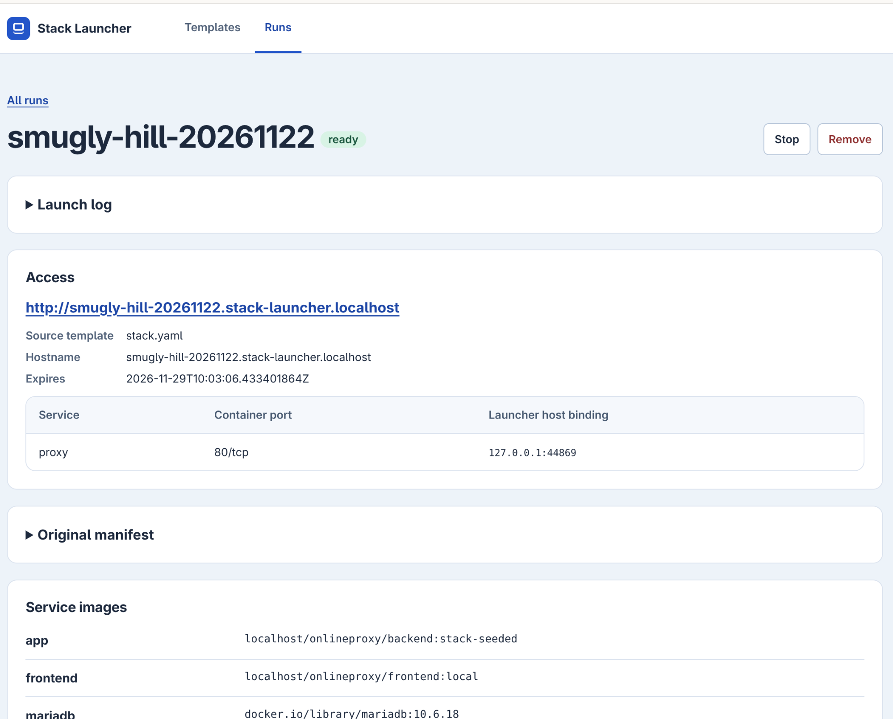
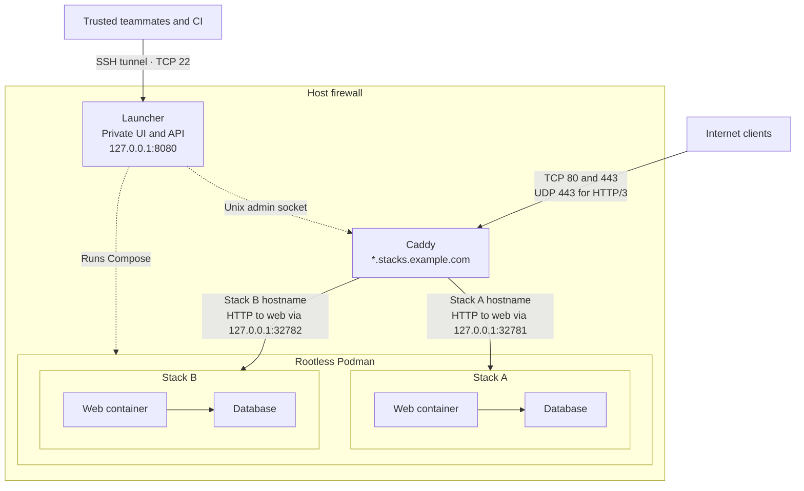

# Quick Ephemeral stacks

Launch temporary Compose stacks for automated tests, manual testing, and demos.
Run multiple versions side by side on one Linux host, using registry images or
images built from Git. Start runs from the web UI or the API.



## How it works



Wildcard DNS points `*.stacks.example.com` at Caddy. Each stack has its own
network and named volumes. Once the services pass their startup checks, the
launcher publishes `<stack-id>.stacks.example.com` in Caddy. This hostname routes
to the manifest's `x-launcher.endpoint` through a dynamically assigned loopback
port. By default, Caddy redirects HTTP to HTTPS and terminates TLS. Additional
Compose TCP ports stay on loopback and can be reached through SSH forwarding.

**Firewall the host.** On the public interface, allow TCP `80` and `443` for
Caddy, TCP `22` for SSH from trusted sources, and optionally UDP `443` for
HTTP/3. Block all other inbound ports. Keep the launcher UI and API on
`127.0.0.1:8080` and use an SSH tunnel to reach them. They can run workloads as
the launcher account.

Runs expire seven days after they become ready by default. Stopping or expiring
a run withdraws its route and keeps its named volumes. **Remove** deletes its
data.

## Quick start

1. On Linux, set up rootless Podman and `podman-compose`. Apply the firewall
   rules above, point wildcard DNS at the host, and start
   [Caddy with the launcher baseline](app/README.md#caddy-routes), a matching
   wildcard certificate, and a Unix admin socket the launcher account can access.
2. From the repository root, build the launcher.

   ```sh
   cd app
   ./dev setup
   ./dev build
   ```

   Put the `stack-launcher` binary from the build report on your `PATH`.

3. As the rootless Podman user, create `~/stack-launcher.yml` with the settings
   below. Edit the domain and socket path to match your Caddy setup.

   ```yaml
   state_dir: stack-launcher-state
   base_domain: stacks.example.com
   caddy_admin_socket: /run/stack-launcher/caddy-admin.sock
   ```

4. Create the state directory beside the config file.

   ```sh
   mkdir -m 700 "$HOME/stack-launcher-state"
   ```

5. Start the launcher.

   ```sh
   stack-launcher -c "$HOME/stack-launcher.yml"
   ```

6. Open `http://127.0.0.1:8080/ui` on the host or through an SSH tunnel. In
   **Templates → New template**, name and save the built-in Nginx example.
   In **Runs**, select that template, click **Create run**, then **Launch run**.
   When the run is ready, open the URL under **Access**. Use **Remove** to clean up.

To run your own stack, see the [Compose manifest guide](MANIFEST.md).

See the [deployment and CI guide](app/docs/quick-start.md) for host setup, Git and
registry access, and the CI helper. The [development guide](app/README.md) covers
the API, Compose options, and checks.

## Architecture decisions

See the [architecture decision records](adr/) for the design rationale.
